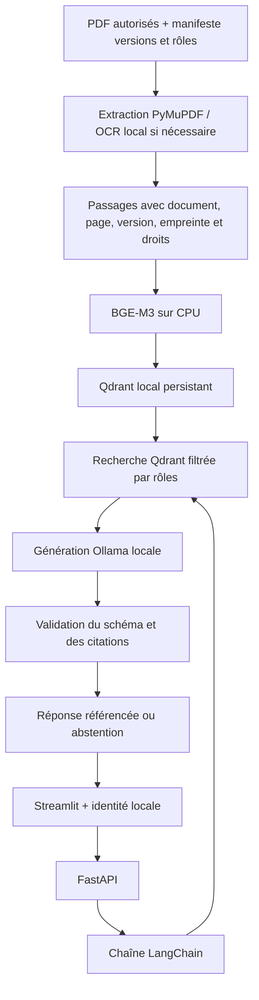

# MaintiDoc V1 — cadrage et architecture (L1.1)

## But et périmètre

Permettre à un technicien authentifié de poser une question textuelle et de recevoir
une réponse accompagnée de références documentaires vérifiables. Les documents sont
des données, jamais des instructions pour l'application. Le système ne pilote aucun
équipement. L'historique MCP, les tickets et les images sont hors périmètre de V1.

Le corpus actuel est **un seul PDF de projet**, la feuille de route fournie.
Il permet de démontrer la chaîne technique, mais ne constitue pas un corpus métier.
Le corpus prévu pour la recette finale reste 30 à 50 documents autorisés couvrant
deux familles d'équipements (pompes et moteurs envisagés).

## Architecture

## Composants et choix

- `maintidoc/ingest.py` : ingestion administrative depuis `config/corpus.json`.
- `maintidoc/embeddings.py` : BGE-M3, vecteurs normalisés, cache local.
- `data/qdrant_v1/` : stockage distinct des anciens exercices, une collection par snapshot.
- `data/index_v1.json` : collection active et métadonnées des documents indexés.
- `maintidoc/rag.py` : chaîne LCEL `RunnableLambda` recherche → génération → validation.
- `prompts/rag_v1.txt` : prompt versionné indépendamment du contenu documentaire.
- `maintidoc/api.py` : authentification, questions, documents accessibles et PDF.
- `ui/streamlit_app.py` : démonstration textuelle, citations et téléchargement autorisé.

Qdrant fonctionne dans un seul processus d'API. L'ingestion s'effectue API arrêtée.
Le serveur Qdrant et Docker Compose seront abordés dans les étapes suivantes.

## Références et versions

Chaque passage conserve : identifiant, document, identifiant documentaire, numéro de
page PDF (à partir de 1), positions des mots, version déclarée, SHA-256 du PDF, rôles,
famille d'équipement et modèle d'embeddings. Le numéro imprimé dans le manuel peut
différer du numéro de page PDF.

Une nouvelle ingestion est activée après indexation réussie. Les anciennes collections
sont conservées et ne sont pas interrogées par la V1. Un PDF modifié après ingestion
ne peut pas être téléchargé comme preuve de l'ancien snapshot : l'API répond 409.
Après changement des droits documentaires, réindexer et redémarrer l'API.
Les identités et leurs rôles sont relus à chaque requête.

## Identités et droits

La démonstration utilise des jetons aléatoires transmis par `Authorization: Bearer`.
Le serveur ne conserve que leur SHA-256 dans `config/users.local.json`. Le jeton de
démonstration est conservé localement dans `data/runtime/demo-token.txt`, exclu de Git.
Le compte de démonstration possède le rôle `technician`.

Le client ne choisit pas ses rôles. Le filtre Qdrant est construit côté serveur à
partir de l'identité et s'applique **avant** la sélection des passages et la génération.
L'accès aux PDF est contrôlé séparément. Il n'existe aucun endpoint d'administration
des droits ni de création de ticket dans V1.

Le jeton prérempli dans Streamlit est une commodité de démonstration locale.
Ce système n'est pas un fournisseur d'identité de production : SSO, HTTPS,
rotation des secrets et limitations d'usage seront traités à l'étape 4.
Les trois services écoutent exclusivement sur `127.0.0.1`.

## Génération et abstention

BGE-M3 retrouve au maximum huit passages autorisés. Si le meilleur score est inférieur
à 0,40, la recherche s'abstient. Sinon, les extraits sont priorisés par recouvrement
lexical avec la question (accents normalisés, quelques mots usuels exclus), puis
par score dense pour départager les candidats. Quatre extraits au maximum sont
présentés au modèle, qui en choisit jusqu'à trois. Il s'agit d'une priorisation
lexicale simple, sans reranker entraîné. Le seuil est expérimental,
configurable par `MAINTIDOC_THRESHOLD`, et doit être
calibré sur le corpus métier ; il ne garantit pas l'absence de résultats hors sujet.

Qwen2.5 1.5B via Ollama sélectionne les identifiants d'extraits préparés par le serveur.
Il ne recopie pas les citations et ne les reformule pas. Une citation ne peut référencer qu'un passage
retrouvé. Le serveur vérifie que chaque citation est réellement présente dans ce
passage (espaces normalisés). Une citation invalide invalide toute la réponse.

L'application s'abstient si les passages manquent, si le modèle déclare le contexte
insuffisant ou si la sortie n'est pas vérifiable. Une panne d'Ollama produit une
erreur 503 explicite. Il n'y a pas de remplacement silencieux par une réponse inventée.

La réponse V1 est **extractive** : elle affiche les citations exactes, sans
reformulation libre du modèle. Ce choix a été retenu après observation d'une
reformulation trop large pour la citation associée lors des essais initiaux.
**Limite :** l'existence d'une citation ne garantit pas sa pertinence pour la question
ni que toutes les informations nécessaires ont été retrouvées. Les réponses doivent
être relues par un technicien.
Le petit modèle est choisi pour cette démonstration CPU, pas pour garantir un diagnostic.
Une seule génération est effectuée par question, avec longueur d'entrée/sortie bornée.

## Ressources et installation

Machine observée : environ 16 Go de RAM, inférence sur CPU. BGE-M3 utilise environ
2,27 Go de poids ; Qwen2.5 1.5B ajoute environ 1 Go. `.venv` réutilise le PyTorch CPU
installé dans Anaconda. Les versions observées sont consignées dans
`environment-versions.json` ; les versions directes de la V1 sont contraintes dans
`constraints-v1.txt`. Il ne s'agit pas encore d'une image Docker reproductible.

Le premier essai en charge a dépassé la mémoire disponible sur cette machine.
Le profil final calcule donc les questions avec BGE-M3 en précision FP16 dans un
processus éphémère ; ce processus se termine avant l'appel d'Ollama. Ollama libère
son modèle après chaque réponse (`keep_alive=0`). Les vecteurs sont renormalisés en
FP32 avant recherche. Ce profil privilégie la mémoire, au prix de rechargements et
d'une latence plus élevée. Les vecteurs documentaires existants restent en FP32.

## Références techniques

- Qdrant local : https://github.com/qdrant/qdrant-client#local-mode
- BGE-M3 : https://huggingface.co/BAAI/bge-m3
- LangChain Runnable : https://reference.langchain.com/python/langchain-core/runnables/
- Sorties structurées Ollama : https://docs.ollama.com/capabilities/structured-outputs
- FastAPI : https://fastapi.tiangolo.com/
